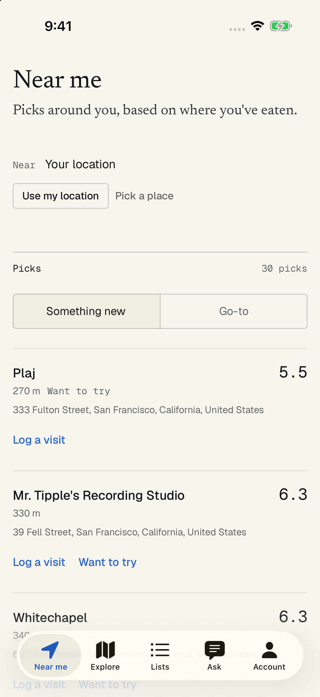
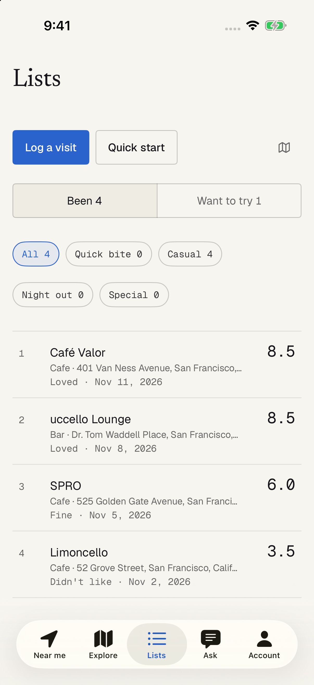
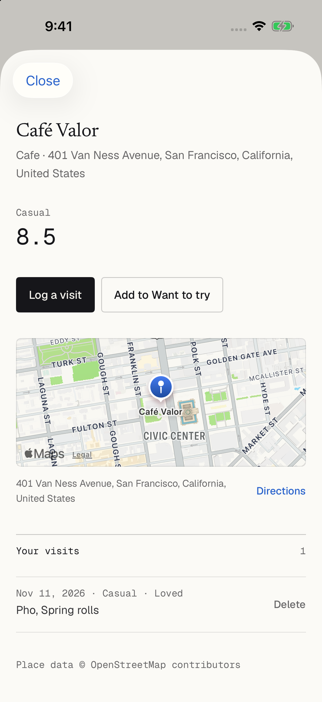
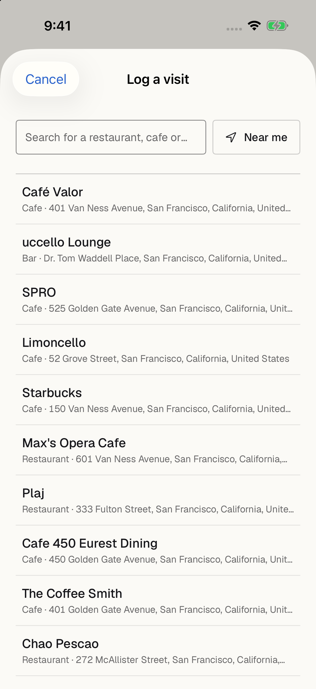
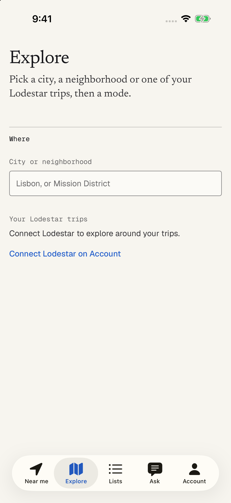
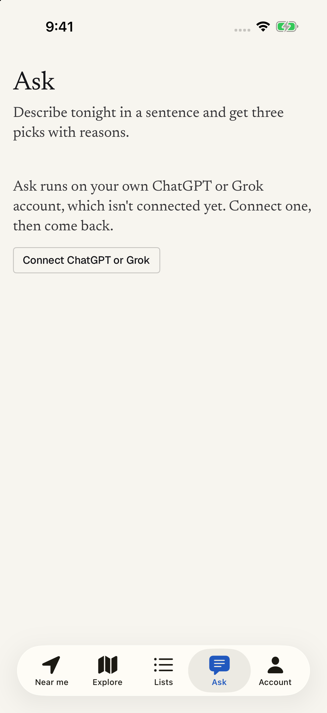
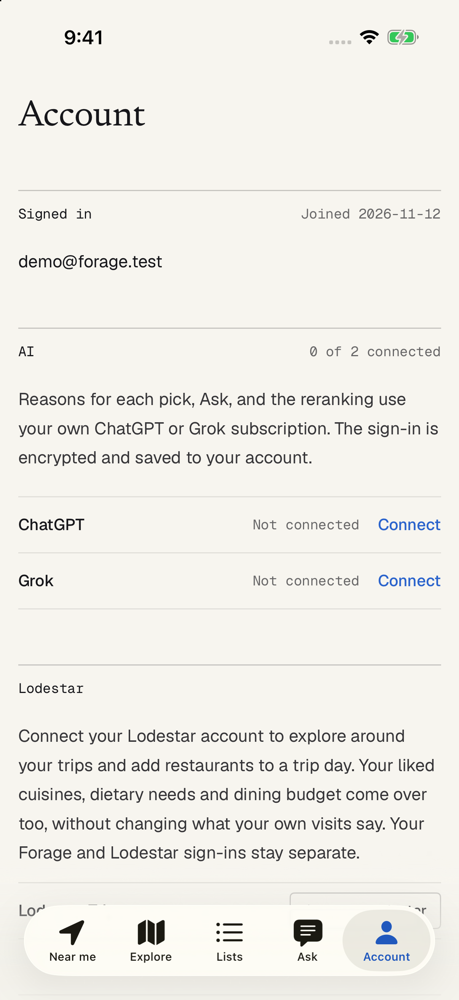
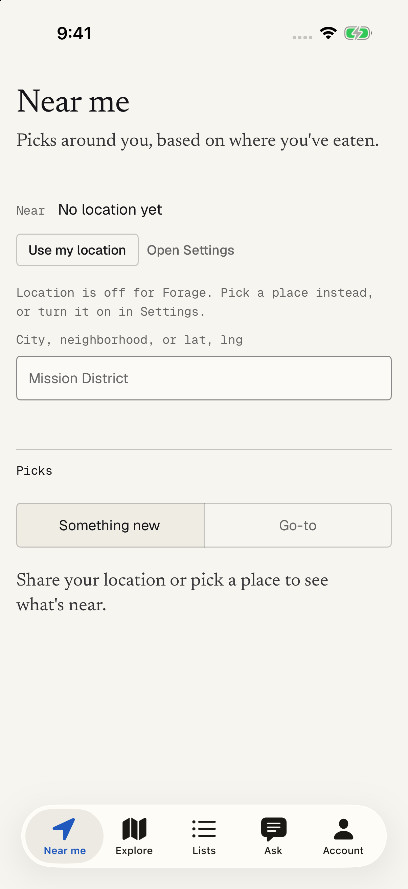
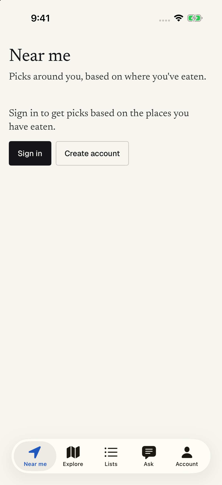

# Forage for iOS

The native SwiftUI app for Forage. It calls the web app's JSON API (`/api/*`) and signs in with the same session cookie. It needs iOS 26 or later, Xcode 27 and XcodeGen, and uses no third-party packages. Maps and location use Apple's MapKit and CoreLocation, so the app adds no running cost.

## What's in it

| Tab or sheet | What it does |
| --- | --- |
| Near me | Picks around your location with Something new / Go-to, predicted scores, and an AI reason per pick when ChatGPT or Grok is connected. With location off it offers a city search and Open Settings. |
| Explore | Picks for a city, neighborhood or Lodestar trip in Travel, Splurge or Stretch mode. With Lodestar linked, Add to trip puts a pick on a trip day. |
| Lists | Been (one row per place and occasion, sorted by score, filter by occasion) and Want to try, as a list or an Apple Maps view. Log a visit and Quick start sit at the top. |
| Ask | A sentence in, three picks with reasons out. Without ChatGPT or Grok connected it shows a Connect button instead. |
| Account | Sign in or create an account, ChatGPT and Grok, Lodestar link and preference import, sign out, delete account. |
| Rate places (full screen) | Opens on launch while under 10 rated places, until closed once on this device; also from Near me and Lists. No account needed: the first write makes a guest. A grid of nearby places (tap every one you've been to, Want to try, Not been, search), then per place Loved it / It was fine / Didn't like it or a score out of 10 with the occasion guessed, then at most one "Which did you like more?" while onboarding. Undo reverses every write. Guests get a save form from 5 rated. |
| Log a visit (sheet) | Place search (as you type or Near me), reaction, occasion, date, dishes and note, then up to two "Which did you like more?" questions. |
| Place (sheet) | Your score per occasion, visits with Delete, "We predicted X, you gave Y", a map with Directions, Want to try. |

Signed out, Near me and Lists show the Rate places prompt; the other tabs show a sign-in prompt, so nothing errors before an account exists.

| | | |
| --- | --- | --- |
|  |  |  |
|  |  |  |
|  |  |  |

Screenshots are from the simulator against a local dev server with seeded data near Civic Center, San Francisco.

How the app is built is described in `docs/ARCHITECTURE.md`. The endpoint contracts are in `docs/api.md`.

## Generate the project

`Forage.xcodeproj` is generated from `project.yml` and is not committed.

```bash
cd ios
brew install xcodegen      # once
xcodegen generate
```

Sources are folder globs. After adding or removing files, run `xcodegen generate` again; `project.yml` does not need editing.

## Build and run

Open `Forage.xcodeproj` in Xcode and run the **Forage** scheme. To build from the command line:

```bash
xcodebuild -project Forage.xcodeproj -scheme Forage \
  -destination 'platform=iOS Simulator,name=iPhone 17 Pro' \
  -derivedDataPath /tmp/forage-ios-dd -jobs 4 build
```

To install and launch on a booted simulator:

```bash
xcrun simctl install booted /tmp/forage-ios-dd/Build/Products/Debug-iphonesimulator/Forage.app
xcrun simctl launch booted co.xanom.forage
```

Debug builds accept these launch arguments (`App/AppState+Debug.swift`):

| Argument | Effect |
| --- | --- |
| `-ForageTab near\|explore\|lists\|ask\|account` | Opens on that tab |
| `-ForageDebugAccount "email password"` | Signs in at launch, creating the account if sign-in fails. Local servers only. |
| `-ForageSheet log\|place:<id>` | Opens the Log sheet or a place once signed in |
| `-ForageRateDemo pick\|rate\|compare\|save\|finish` | Opens Rate places and drives it to that step, for screenshots (`docs/screenshots/rate-*.png`) |
| `-rateDismissedAt 1` | Treats Rate places as closed before, so launch lands on the tabs |

## Test

```bash
xcodebuild -project Forage.xcodeproj -scheme Forage \
  -destination 'platform=iOS Simulator,name=iPhone 17 Pro' \
  -derivedDataPath /tmp/forage-ios-dd -jobs 4 test
```

The tests use Swift Testing and are in `ForageTests/`, one folder per area. None of them call the network: models are decoded from fixtures, and the client is tested against stubbed `URLProtocol` responses.

## Point at a local server

The default server is `https://forage.xanom.co`, set by `ForageBaseURL` in `Info.plist`. To use the dev server (`pnpm dev` in the repo root), launch with an override:

```bash
xcrun simctl launch booted co.xanom.forage -apiBaseURL http://localhost:3000
```

In Xcode, add `-apiBaseURL http://localhost:3000` under Scheme > Run > Arguments. Debug builds also have Account > Developer, with "Use localhost:3000" and "Use production"; the change applies the next time the app opens. The value is stored in the `apiBaseURL` user default. App Transport Security allows plain HTTP to local addresses. On a physical device, use your Mac's LAN address instead of `localhost`.

A full local run, as used for the screenshots:

```bash
# repo root: throwaway in-memory database on a spare port
FORAGE_SECRET=$(openssl rand -hex 32) DATABASE_URL=pglite://memory pnpm dev --port 3107

# ios/: one simulator, location granted and set
xcrun simctl boot "iPhone 17 Pro"
xcrun simctl install booted /tmp/forage-ios-dd/Build/Products/Debug-iphonesimulator/Forage.app
xcrun simctl privacy booted grant location co.xanom.forage
xcrun simctl location booted set 37.7793,-122.4193
xcrun simctl launch booted co.xanom.forage -apiBaseURL http://localhost:3107 \
  -ForageDebugAccount "demo@forage.test some-long-password" -ForageTab near
xcrun simctl io booted screenshot near.png
xcrun simctl shutdown booted
```

The app sends no `Origin` header, so the server's same-origin check passes without any backend changes.

## Links into the app

The app handles these links (`App/DeepLink.swift`):

| Link | Opens |
| --- | --- |
| `forage://reset?token=…` | The "choose a new password" form, with the token filled in |
| `https://forage.xanom.co/reset?token=…` | The same, once universal links are set up |

The emailed reset link is an `https` URL, so it opens the app only after universal links are set up. That needs two changes:

1. The web app serves `/.well-known/apple-app-site-association`, listing `/reset` for `VTQW687WBQ.co.xanom.forage`.
2. The app gets the `com.apple.developer.associated-domains` entitlement with `applinks:forage.xanom.co`.

Until then, users paste the link into Account > "Have a reset link?".

## Fonts and icon

Geist and Geist Mono (copied from the Lodestar app) and Newsreader Regular are bundled under the SIL Open Font License; the licences are in `Forage/Resources/Fonts/`. The app icon is a generated placeholder: a Newsreader "f" and one blue dot on the dark canvas.

## Known gaps

- Connect Lodestar uses an in-app web view until the web adds the JSON callback from `docs/api.md` §11; the native `ASWebAuthenticationSession` flow is written and switched off.
- Editing a visit has no screen yet (the place sheet offers Delete, like the web).
- Choosing Log a visit from a place sheet replaces the sheet; after logging you land back on the tab.
- Want to try is removed with a long press on the row (or from the place sheet), not a swipe.
- ChatGPT/Grok sign-in and Lodestar connect were not run end to end in the simulator; they need real accounts.

## Cost

Nothing here costs money: MapKit, CoreLocation, AuthenticationServices and WebKit are Apple's, place data is OpenStreetMap through Forage's server, and AI runs on the user's own ChatGPT or Grok subscription. The app never calls Google; live Google details appear only if the server owner sets `GOOGLE_PLACES_KEY`.
